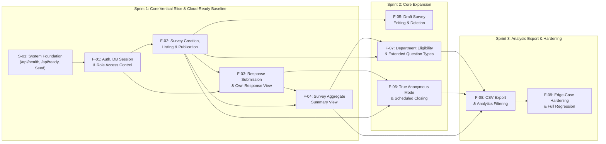

# Feature Inventory (`docs/features.md`)
**Product Name:** Pollipop — University Review, Feedback, and Survey System  
**Repository:** `https://github.com/phatthidawadi/pollipop`  
**Team Members:**  
- **Student 1 (Author / Collaborator):** ภัทร์ธิดาวดี อุ่นคำ / Phatthidawadi Aunkham (67070505225, GitHub: `@phatthidawadi`)  
- **Student 2 (Author / Collaborator):** ปทิตญา แก้ววิเชียร / Patitaya Kaewwichian (67070505220, GitHub: `@lmaybelgracel`)  

---

## 1. Product Feature Inventory across 3 Sprints

The table below lists all product features for **Pollipop**, indexed by stable identifiers (`Feature ID`), summary descriptions, associated requirements (`FR`, `BR`, `NFR`), dependency prerequisites, and targeted delivery sprints:

| Feature ID | Feature Name & Scope Summary | Associated Requirements | Dependencies | Planned Sprint |
| :--- | :--- | :--- | :---: | :---: |
| **S-01** | **System Foundation, Health & Readiness Probes:** Three-tier project scaffolding (Express + React Vite + Prisma PostgreSQL), environment variable configuration, idempotent database seeding (`prisma.user.upsert`), and operational probes for service liveness (`GET /api/health`) and database connectivity (`GET /api/ready`). | FR-03, NFR-02, NFR-04, NFR-05, A-01, A-08 | None | **Sprint 1** |
| **F-01** | **Authentication, Database Session & Role-Based Access Control:** User login (`POST /api/auth/login`), logout (`POST /api/auth/logout`), current profile inspection (`GET /api/auth/me`) using database sessions (`pollipop_sid` HTTP-only cookie), `bcrypt` password hashing, RBAC enforcement (`OWNER` vs `RESPONDENT`), and back-button cache prevention (`Cache-Control: no-store` + `pageshow` guard). | FR-01, FR-02, BR-05, NFR-01, NFR-02, NFR-05 | S-01 | **Sprint 1** |
| **F-02** | **Survey Creation, Listing & Lifecycle Management:** `OWNER` creates surveys in `DRAFT` status with `SINGLE_CHOICE` (2–10 options) and `RATING` (scale 1–5) questions; transitions survey state to `PUBLISHED` (`POST /api/surveys/:id/publish`) or `CLOSED` (`POST /api/surveys/:id/close`); enforces owner isolation (`BR-04`) and post-publish immutability (`BR-11`); displays role-specific listings (`GET /api/surveys` with `answered` and `responseId` for respondents). | FR-04, FR-05, FR-06, FR-07, FR-12, BR-03, BR-04, BR-05, BR-07, BR-08, BR-11, NFR-04 | F-01 | **Sprint 1** |
| **F-03** | **Validated Response Submission & Own Response Inspection:** `RESPONDENT` inspects open surveys (`GET /api/surveys/:id`), submits validated answers (`POST /api/surveys/:id/responses`) within an atomic database transaction, blocks duplicate submissions (`409 ALREADY_SUBMITTED`), rejects submissions to draft/closed surveys (`404` / `409`), handles optional questions, and enables review of own answers (`GET /api/responses/:id`) with cross-response privacy guards (`403 Forbidden`). | FR-08, FR-09, BR-01, BR-02, BR-05, BR-06, BR-07, BR-09, BR-12, NFR-03, NFR-04 | F-01, F-02 | **Sprint 1** |
| **F-04** | **Survey Aggregate Summary & Analytics Dashboard:** `OWNER` inspects real-time server-side calculated summary statistics (`GET /api/surveys/:id/summary`): total responses, option counts/percentages for single-choice questions, and rating mean (2 decimals) with frequency distribution, guarded against unauthorized viewers (`403 Forbidden`). | FR-10, BR-04, BR-05, BR-10, BR-13 | F-02, F-03 | **Sprint 1** |
| **F-05** | **Draft Survey Editing & Question Reordering:** `OWNER` can modify survey titles, descriptions, question orders, and choices, or delete survey records while strictly in `DRAFT` status (`409 Conflict` on published/closed states). | FR-11, BR-03, BR-04, BR-11, NFR-04 | F-02 | **Sprint 2** |
| **F-06** | **True Anonymous Survey Mode & Scheduled Expiration:** Support for `ANONYMOUS` surveys with decoupled participation logging (`SurveyParticipation`) and unlinked responses (`Response.respondentId = null`), combined with scheduled closing via `closesAt` timestamps. | FR-12, FR-13, BR-01, BR-02, BR-13, NFR-03 | F-02, F-03 | **Sprint 2** |
| **F-07** | **Department Eligibility Control & Extended Question Types:** Restricting survey eligibility to specific student faculties/departments (`targetDepartment`), alongside multi-select (`MULTIPLE_CHOICE`) and free-form (`SHORT_TEXT`) question types. | FR-14, FR-15, BR-08, BR-09, BR-10, BR-12, NFR-04 | F-02, F-03, F-04 | **Sprint 2** |
| **F-08** | **Survey Results CSV Export & Filtering:** `OWNER` can export aggregate summary reports and anonymized raw response datasets as CSV files, with demographic filtering capabilities. | FR-16, BR-04, BR-05, BR-10, BR-13 | F-04, F-06, F-07 | **Sprint 3** |
| **F-09** | **Edge-Case Hardening, Accessibility & Full Regression Suite:** Handling race conditions, network failures, session timeouts, WCAG accessibility compliance, and end-to-end regression validation. | NFR-01, NFR-03, NFR-04, NFR-05 | All Features | **Sprint 3** |

---

## 2. Feature Dependency Graph

